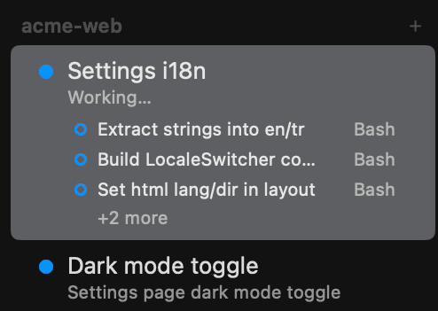
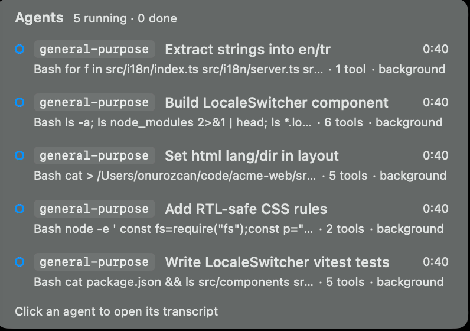
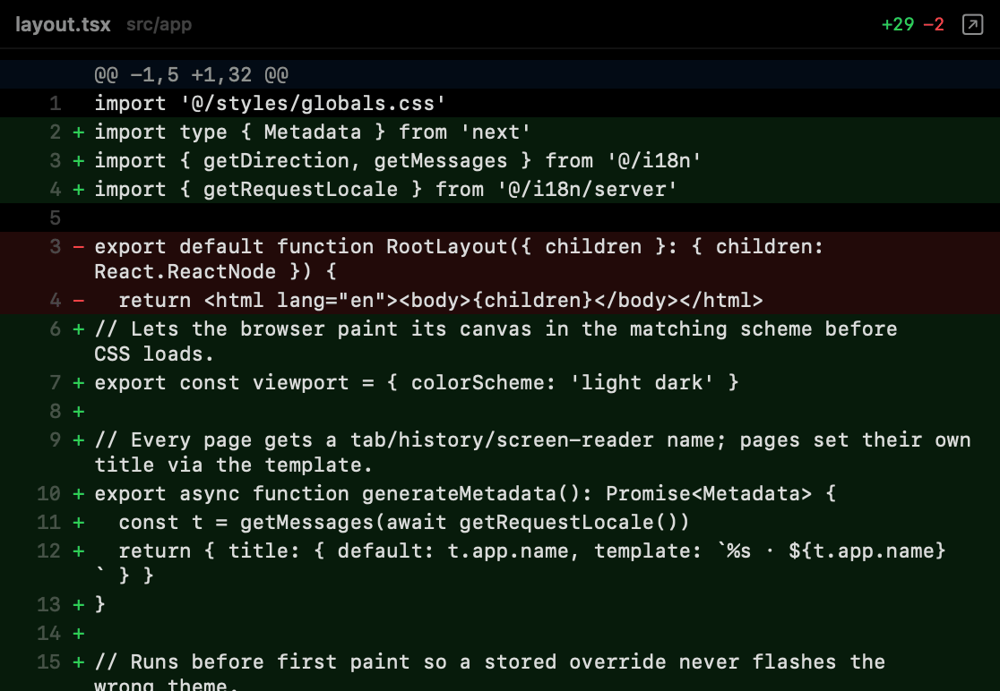
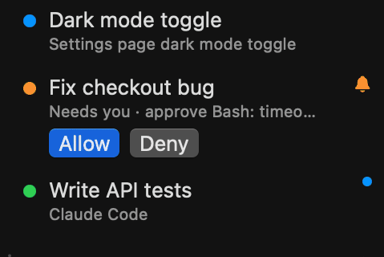

# omux

**The terminal for running fleets of coding agents.** A native macOS app that keeps many [Claude Code](https://claude.com/claude-code) and [Codex](https://developers.openai.com/codex/cli) sessions in one window, shows you which one needs you, and gives each its own branch.


[**Download the latest release**](https://github.com/onurozcan/omux/releases/latest) · signed and notarized · Apple Silicon, macOS 14+

## Why omux

- **Many agents, one window.** Projects in a sidebar, sessions under them, each one resumes its exact conversation after a relaunch.
- **See who needs you.** Working, needs you or done, per session. The Dock badge counts the ones waiting, and a notification brings you to the right one.
- **Each session on its own branch.** Worktree sessions get a branch and a folder, so parallel agents never touch each other's files. The pull request's checks and reviews show up next to the session.

## What it looks like

<table>
<tr>
<td width="50%" valign="top">

<b>Every agent in the sidebar.</b><br>Status, subagents and approvals per session. Drag to reorder, rename, color.
</td>
<td width="50%" valign="top">

<b>See what the subagents are doing.</b><br>Every subagent of Claude Code or Codex, with its current tool. Click one to read its transcript.
</td>
</tr>
<tr>
<td width="50%" valign="top">

<b>Review the diff, leave notes.</b><br>The session's changes against its base branch. Click a line to leave a note, then send them all to the agent in one message.
</td>
<td width="50%" valign="top">

<b>Allow or deny without switching.</b><br>Claude Code tool permissions and Codex approvals, answered from the sidebar or the header. Deny lets you tell the agent what to do instead.
</td>
</tr>
</table>

## Features

| Feature | What it does |
| --- | --- |
| **Projects and sessions** | A project is a folder plus a default agent. Sessions live under it in the sidebar: drag to reorder, rename, color, move between projects. |
| **Conversations that resume** | Each Claude Code session keeps its session ID and each Codex session its thread, so Restart and relaunch reopen the exact conversation. |
| **Live status** | Working, needs you or done, per session. The Dock badge counts sessions waiting on you, and a notification brings you to the right one. |
| **Allow or deny from the sidebar** | Claude Code tool permissions and Codex approvals answered without switching sessions. Deny lets you tell the agent what to do instead. |
| **Subagents** | Every subagent of Claude Code or Codex listed with its current tool. Click one to read its transcript. |
| **Worktree sessions** (⌥⌘T) | A session on its own branch and folder, so parallel agents never touch each other's files. A per-project setup command runs first, like `cp "$OMUX_REPO/.env" . && npm install`. |
| **Pull request status** | With the [GitHub CLI](https://cli.github.com): checks, reviews and merges next to the session. Failing checks' logs sent to the agent in one click. Merged pull requests offer to clean up the worktree. |
| **Changes** (⌥⌘2) | The session's diff against its base branch. Click a line to leave a note, then send all notes to the agent in one message. |
| **Files** (⌥⌘1) | The session's folder, with previews of code, Markdown, images, PDFs and anything Quick Look shows. ⌘-click a path in the terminal to preview it. |
| **Browser** (⌥⌘3) | A web view per session that opens the local server the session prints. Pick an element to send its HTML, styles and a screenshot to the prompt. |
| **Images and files in the prompt** | Paste an image or drop files onto the terminal, and the agent gets their paths as attachments. |
| **Recent conversations** (⇧⌘O) | Claude Code's and Codex's recent conversations, reopened as sessions. |
| **Usage limits** | The selected provider's plan limits at the bottom of the sidebar. |
| **Open folders from anywhere** | Finder's "Open in omux", a folder dropped on the Dock icon, or `open -a omux <folder>`. |
| **The rest** | Notifications with the macOS sound of your choice, themes, terminal fonts, a quick switcher (⌘K), signed automatic updates. |

Details for every row are in [docs/features.md](docs/features.md). Codex sessions have [their own page](docs/codex.md).

## Install

Download `omux-<version>.dmg` from the [latest release](https://github.com/onurozcan/omux/releases/latest), open it and drag omux to Applications. The app is signed with a Developer ID and notarized, so it opens without a warning.

Or build it yourself, which installs into `/Applications`:

```sh
./build.sh
open /Applications/omux.app
```

Beta builds, distribution builds and tests are described in [docs/building.md](docs/building.md).

## Requirements

- A Mac with Apple Silicon running macOS 14 or later
- [Claude Code](https://claude.com/claude-code) installed as `claude` for Claude sessions; plain shell sessions work without it
- Codex CLI 0.165.0 or later installed as `codex` for Codex sessions
- To build from source: Swift 6.2 or later (Xcode 26 or the Command Line Tools)

## Keyboard shortcuts

| Action | Shortcut |
| --- | --- |
| New session / new shell / new project | ⌘T / ⇧⌘T / ⇧⌘N |
| New session in a worktree | ⌥⌘T |
| Open folder / recent conversation | ⌘O / ⇧⌘O |
| Close session | ⌘W |
| Rename / edit session | ⌘R / ⌘I |
| Restart session | ⇧⌘R |
| Interrupt (Ctrl-C) | ⇧⌘. |
| Start or continue the session | ⇧⌘↩ |
| Jump to session | ⌘K |
| Next / previous session | ⇧⌘] / ⇧⌘[ |
| Session 1–9 in the current project | ⌘1 … ⌘9 |
| Right panel / Files / Changes / Browser | ⌥⌘F / ⌥⌘1 / ⌥⌘2 / ⌥⌘3 |
| Terminal font bigger / smaller / default | ⌘+ or ⌘= / ⌘− / ⌘0 |

## Privacy

omux has no telemetry. It talks to the network for three things: your plan's usage limits (with Claude Code's own login, read from the Keychain), pull request status through `gh`, and a daily update check against omux.app. Nothing about you or your machine is sent. Every network path and local file is listed in [docs/privacy.md](docs/privacy.md).

## Contributing

Pull requests are welcome. The [changelog](CHANGELOG.md) lists what changed in each version, with its pull request.

omux is an independent project and is not affiliated with or endorsed by Anthropic or OpenAI. Claude and Claude Code are trademarks of Anthropic.

## License

[MIT](LICENSE)
