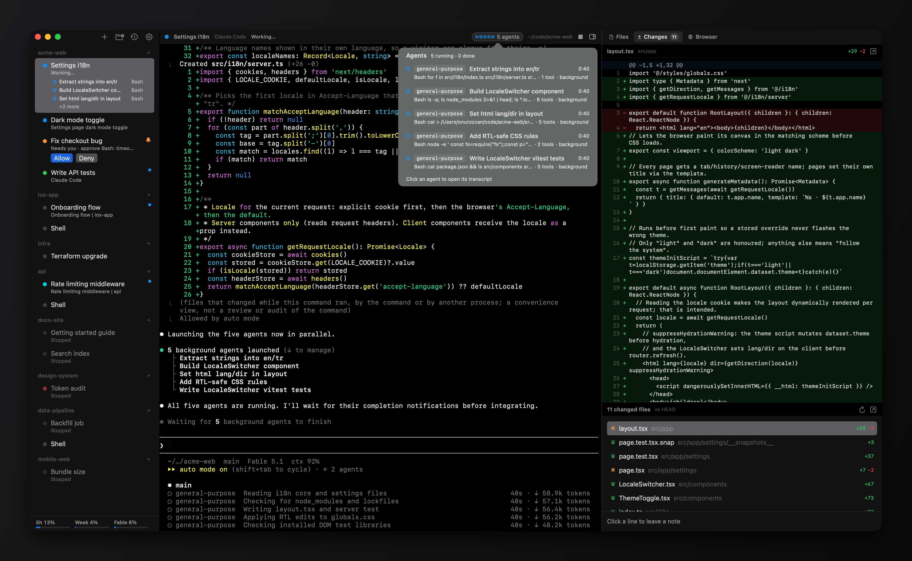

# omux

A native macOS terminal for running many [Claude Code](https://claude.com/claude-code) sessions side by side. Sessions are grouped into projects in a sidebar, each one keeps its own Claude conversation across relaunches, and a files panel previews whatever the session is working on.



Built with SwiftUI and [SwiftTerm](https://github.com/migueldeicaza/SwiftTerm).

## Features

- **Projects and sessions.** A project is a folder plus a default command; sessions live under it in the sidebar. Drag to reorder or move sessions between projects, rename them, and give them colors.
- **Conversations that resume.** Each session that runs `claude` is pinned to its own session id, so quitting and reopening omux continues the same conversation.
- **Live status.** Each session shows whether Claude is working, needs you or is done, and the Dock badge counts sessions waiting on you.
- **Notifications.** When a session you aren't looking at needs you, omux posts a macOS notification; clicking it opens the session. Notifications for finished sessions are optional. Programs can send their own with OSC 9 or OSC 777: set Claude Code's notification channel to `ghostty` (in `/config`) to get its notifications, and its plugins', this way. Turn each kind on or off in Settings › Notifications.
- **Allow or deny from the sidebar.** When Claude asks for a tool permission, Allow and Deny appear under the session and in its header, so you can answer without switching to it.
- **Subagents.** While Claude runs subagents, the selected session lists them in the sidebar with what each one is doing; other sessions show a count. The header's agents button lists them all, and clicking one opens its transcript in the right panel.
- **Worktree sessions** (⌥⌘T). A session can get its own Git branch and folder (`<repo>.worktrees/<branch>` next to the repo), so parallel sessions don't touch each other's files. Turn it on per project to make it the default. A project can also have a setup command that runs in each new worktree before the session starts, such as `cp "$OMUX_REPO/.env" . && npm install` (`$OMUX_REPO` is the main checkout), so files Git ignores and dependencies are there before Claude begins. Right-click a worktree session to create a pull request, merge it into its base branch or open its folder; closing one asks whether to keep or delete the worktree.
- **Pull request status.** With the [GitHub CLI](https://cli.github.com) installed, a worktree session whose branch has a pull request shows its number and state in the sidebar and header: checks running or failing, changes requested, approved or merged. Click the header chip to see each check and open it on GitHub. The session asks for your attention when checks start failing, a review comes in or the pull request is merged. Once it's merged, the session offers to delete its worktree and branch.
- **Right panel** (⌥⌘F), with three tabs:
  - **Files** (⌥⌘1). Browses the session's folder and previews Markdown, code and text (with optional line wrapping), images, PDFs, audio, video, and anything else Quick Look can show. File paths mentioned in the session's output are listed at the top; ⌘-click a path in the terminal to preview it.
  - **Changes** (⌥⌘2). The session's diff: against the base branch for worktree sessions, uncommitted changes otherwise. Click a line to leave a note, then send all notes to Claude in one message.
  - **Browser** (⌥⌘3). A web view per session that opens the local server the session prints (like `localhost:3000`). The pick button sends an element's HTML, styles and a screenshot to the prompt.
- **Recent conversations** (⇧⌘O). Reopen any Claude Code conversation found in `~/.claude/projects`.
- **Usage limits.** The sidebar shows your Claude plan's 5-hour and weekly limits (see [Privacy](#privacy)).
- **Open folders from anywhere.** Finder's right-click "Open in omux" service, dropping a folder on the Dock icon, or `open -a omux <folder>`.
- Themes, terminal font and size, and a quick switcher (⌘K).

## Requirements

- macOS 14 or later
- Swift 5.9 or later (Xcode 15+ or the Command Line Tools)
- [Claude Code](https://claude.com/claude-code) installed as `claude` for Claude sessions; plain shell sessions work without it

## Build

```sh
./build.sh
open /Applications/omux.app
```

`build.sh` builds a release binary, assembles `build/omux.app`, and then **replaces `/Applications/omux.app`** so the Finder service and Dock entry stay registered. It signs with the first "Apple Development" certificate in your keychain, or ad hoc if there is none.

## Keyboard shortcuts

| Action | Shortcut |
| --- | --- |
| New session / new shell / new project | ⌘T / ⇧⌘T / ⇧⌘N |
| New session in a worktree | ⌥⌘T |
| Open folder / recent Claude conversation | ⌘O / ⇧⌘O |
| Close session | ⌘W |
| Rename / edit session | ⌘R / ⌘I |
| Restart session | ⇧⌘R |
| Interrupt (Ctrl-C) | ⇧⌘. |
| Continue Claude conversation | ⇧⌘↩ |
| Jump to session | ⌘K |
| Next / previous session | ⇧⌘] / ⇧⌘[ |
| Session 1–9 in the current project | ⌘1 … ⌘9 |
| Right panel / Files / Changes / Browser | ⌥⌘F / ⌥⌘1 / ⌥⌘2 / ⌥⌘3 |

## Privacy

omux has no telemetry and makes two kinds of network request:

- **Usage limits.** To show your plan limits, omux reads Claude Code's login from the macOS Keychain (the `Claude Code-credentials` item, via `/usr/bin/security`) and sends it to `https://api.anthropic.com/api/oauth/usage`, the same endpoint Claude Code's `/usage` command uses. The token is never written to disk or logged. This endpoint is undocumented and may change or stop working at any time.
- **Pull request status.** If `gh` is installed, omux runs `gh pr view` for each worktree session's branch about once a minute and when you switch back to omux. gh uses its own login; omux never reads or stores your GitHub token.

Local files omux touches:

- `~/Library/Application Support/omux/workspace.json`: your projects and sessions (plus a `.bak` copy).
- `~/.claude/projects`: read to list recent conversations, to check whether a session's conversation exists, and to show a running session's subagents and their transcripts.
- Worktree sessions run `git` in your repository, and creating a pull request runs `git push` through your login shell. Nothing else is pushed or committed unless you confirm it.
- Elements picked in the browser are saved under your temporary folder (`omux-picks`) so Claude can read them.
- Settings are stored in the standard macOS preferences.

## Disclaimer

omux is an independent project and is not affiliated with or endorsed by Anthropic. Claude and Claude Code are trademarks of Anthropic.

## Changelog

See [CHANGELOG.md](CHANGELOG.md) for what changed in each version.

## License

[MIT](LICENSE)
